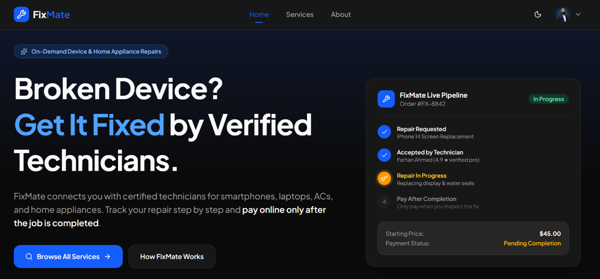

# FixMate

FixMate is a smart device and home appliance repair booking platform. Customers can browse services, book repairs, track booking status, and pay securely. Technicians can manage services and handle repair requests, while admins can manage users, services, bookings, and transactions.



## Live URL

- Frontend: [https://fixmate-rouge-seven.vercel.app](https://fixmate-rouge-seven.vercel.app)

## Purpose

The purpose of FixMate is to make repair service booking simple and transparent. It connects customers with technicians, manages the full booking lifecycle, and supports online payment after service completion.

## Test Credentials

| Role | Email | Password |
| --- | --- | --- |
| Customer | `customer2@fixmate.com` | `Abcd1234` |
| Technician | `technician2@fixmate.com` | `Abcd1234` |
| Admin | `ADD_ADMIN_EMAIL` | `ADD_ADMIN_PASSWORD` |

> Replace the admin credentials above with the real admin test account before submission, if needed.

## Key Features

- **Authentication & Roles:** Email/password and Google sign-in with Better Auth, role-based dashboard access for customer, technician, and admin.
- **Public Service Browsing:** Browse approved services with search, category filter, service mode filter, and sort. Filters are synced to the URL.
- **Service Details & Booking:** Customers can view service details and book a repair with preferred date, address, phone, and problem description.
- **Duplicate Booking Prevention:** Prevents duplicate active bookings for the same customer and service when status is `requested`, `accepted`, or `in-progress`.
- **Customer Dashboard:** View bookings, booking status, and payment history.
- **Technician Dashboard:** Add/edit/delete services, toggle availability, review requests, accept/reject bookings, and move jobs through the workflow.
- **Admin Dashboard:** Manage users, change roles, review/approve services, view bookings, and view payment transactions.
- **Booking Workflow:** Server-enforced status pipeline: `requested -> accepted -> in-progress -> completed -> paid`, with rejection/cancellation guards.
- **Stripe Payment:** Secure Stripe Checkout for completed bookings, webhook-based payment fulfillment, idempotent payment recording, and success/cancel payment pages.
- **Profile Management:** Users can update profile information; name changes sync to related booking/service history.
- **Dark Mode:** Light/dark theme support using `next-themes`.
- **Responsive UI:** Built with Tailwind CSS and shadcn/ui components for desktop and mobile.

## Tech Stack

- **Frontend:** Next.js 16 (App Router), React 19, TypeScript
- **Styling:** Tailwind CSS 4, shadcn/ui, Lucide React
- **Auth:** Better Auth, MongoDB Adapter, JWT
- **Database:** MongoDB
- **Payments:** Stripe
- **Charts:** Recharts
- **Deployment:** Vercel

## NPM Packages Used

### Dependencies

- `next`
- `react`
- `react-dom`
- `typescript`
- `better-auth`
- `@better-auth/mongo-adapter`
- `mongodb`
- `stripe`
- `next-themes`
- `tailwindcss`
- `@tailwindcss/turbopack`
- `shadcn`
- `@shadcn/react`
- `@base-ui/react`
- `lucide-react`
- `react-icons`
- `recharts`
- `date-fns`
- `react-day-picker`
- `embla-carousel-react`
- `cmdk`
- `input-otp`
- `react-resizable-panels`
- `shiki`
- `class-variance-authority`
- `cn`
- `tw-animate-css`
- `server-only`

### Dev Dependencies

- `eslint`
- `eslint-config-next`
- `@types/node`
- `@types/react`
- `@types/react-dom`
- `babel-plugin-react-compiler`

## Environment Variables

Create a `.env.local` file in the frontend root and add:

```env
MONGODB_URI=your_mongodb_uri
BETTER_AUTH_URL=your_better_auth_url
BETTER_AUTH_SECRET=your_better_auth_secret
GOOGLE_CLIENT_ID=your_google_client_id
GOOGLE_CLIENT_SECRET=your_google_client_secret
NEXT_PUBLIC_SERVER_URL=your_express_server_url
NEXT_PUBLIC_IMGBB_API_KEY=your_imgbb_api_key
NEXT_PUBLIC_BETTER_AUTH_URL=your_better_auth_url
STRIPE_SECRET_KEY=your_stripe_secret_key
STRIPE_WEBHOOK_SECRET=your_stripe_webhook_secret
```

## Run Locally

1. Clone the repository.

```bash
git clone <your-repo-url>
cd fixmate
```

2. Install dependencies.

```bash
npm install
```

3. Add environment variables in `.env.local`.

4. Start the development server.

```bash
npm run dev
```

5. Open [http://localhost:3000](http://localhost:3000).

## Available Scripts

```bash
npm run dev
npm run build
npm run start
npm run lint
```

## Notes

- The frontend expects a running Express/MongoDB backend for service, booking, user, and payment API data.
- Stripe webhook endpoint for deployment: `/api/webhooks/stripe`.
- For local Stripe webhook testing, use Stripe CLI and forward events to `localhost:3000/api/webhooks/stripe`.
